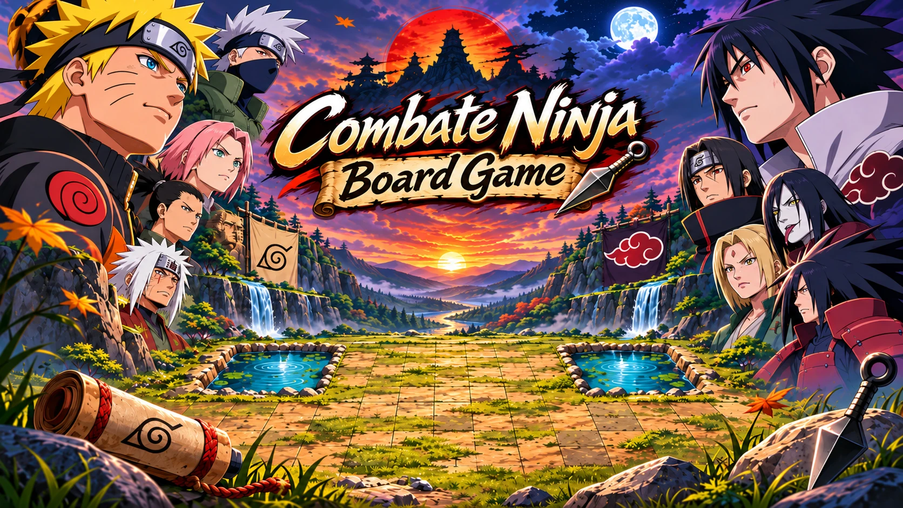
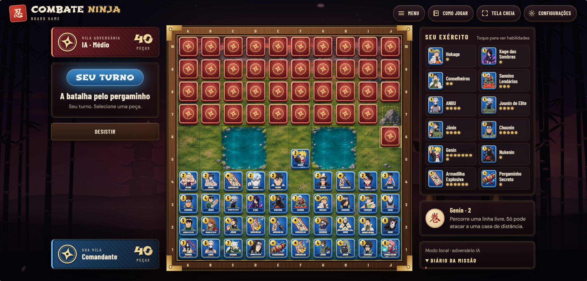

# Combate Ninja Board Game



Jogo de estratégia 2D para navegador inspirado no clássico **Combate**, com personagens e hierarquias do universo Naruto. Dois exércitos disputam um tabuleiro 10 × 10, protegendo suas identidades e buscando capturar o Pergaminho Secreto do adversário.

O projeto reúne tela de entrada, preparação de exército, inteligência artificial, integração multiplayer Firebase, animações de confronto e painel de referência das hierarquias.

## Gameplay



Cada jogador comanda **40 peças**, posicionadas nas quatro fileiras do seu lado do campo. Os dois lagos centrais bloqueiam a passagem e criam corredores de ataque. As peças próprias mostram sua frente, enquanto as inimigas permanecem com o verso visível até participarem de um confronto.

### Objetivo e regras

- Capture o Pergaminho Secreto inimigo ou deixe o adversário sem movimentos válidos.
- Os jogadores alternam turnos, movimentando uma peça por vez.
- Peças comuns avançam uma casa na vertical ou horizontal. Peças e lagos impedem a passagem.
- Genin percorre várias casas livres em linha reta, mas só pode atacar a uma casa de distância.
- Armadilhas e pergaminhos são imóveis.
- A maior força vence. Forças iguais eliminam ambas as peças.
- Chuunin desativa armadilhas. Outros atacantes são eliminados junto com a armadilha.
- Itachi derrota o Hokage quando inicia o ataque.
- A mesma peça pode percorrer a mesma ligação até seis vezes consecutivas nos seus turnos, equivalentes a três idas e voltas.
- Os confrontos revelam as identidades por aproximadamente 2,6 segundos. Depois, a peça inimiga sobrevivente volta ao verso.

### Hierarquias

| Força | Hierarquia | Representação | Quantidade |
| --- | --- | --- | --- |
| 10 | Hokage | Naruto | 1 |
| 9 | Kage das Sombras | Sasuke | 1 |
| 8 | Conselheiros | Sakura e Shikamaru | 2 |
| 7 | Sannins Lendários | Jiraiya, Tsunade e Orochimaru | 3 |
| 6 | ANBU | Ninjas ANBU | 4 |
| 5 | Jounin de Elite | Kakashi, Guy e outros | 4 |
| 4 | Jōnin | Ninjas Jōnin | 4 |
| 3 | Chuunin | Ninjas Chuunin | 5 |
| 2 | Genin | Ninjas Genin | 8 |
| 1 | Nukenin | Itachi | 1 |
| Especial | Armadilha Explosiva | Selo explosivo | 6 |
| Especial | Pergaminho Secreto | Objetivo da partida | 1 |

## Funcionalidades

- Preparação por clique ou arrastar e soltar, troca de posições e formação aleatória.
- IA nos níveis Fácil, Médio e Difícil, com heurísticas de movimento, avaliação de confrontos e memória das revelações.
- Destaque de movimentos válidos, animações e avisos de turno e resultado.
- Painel do próprio exército com forças, habilidades e quantidades restantes.
- Histórico de movimentos, desistência e revanche.
- Tela cheia, modo Apenas Tabuleiro e redução de animações.
- Layout adaptável a computadores e dispositivos móveis.
- Multiplayer com autenticação anônima, salas por código e listagem de salas públicas.
- Sincronização em tempo real, indicação de conexão e reconexão pela mesma sessão.

O modo contra IA funciona localmente. O multiplayer exige configurar e publicar os serviços Firebase. A utilização e a validação entre computadores dependem desse ambiente.

## Tecnologias

| Tecnologia | Uso |
| --- | --- |
| HTML5 | Estrutura das telas e controles |
| CSS3 | Tabuleiro, peças, cenários, animações e responsividade |
| JavaScript com ES Modules | Interface, regras, confrontos, turnos e IA |
| Node.js | Servidor HTTP local, build e runtime das Functions |
| Firebase Authentication | Sessões anônimas dos jogadores |
| Cloud Firestore | Salas, estado das partidas e sincronização |
| Cloud Functions for Firebase | Validação das operações no servidor |
| Firebase Admin SDK | Acesso do servidor aos dados protegidos |
| Firebase Hosting | Publicação da aplicação web |
| PNG, WebP e SVG | Artes do campo, personagens, menu e cenário |
| Google Fonts | Fontes carregadas pela interface |

## Requisitos

### Execução local

- Node.js **22 ou superior** e npm.
- Navegador moderno com ES Modules e CSS Grid.
- Git para clonar o repositório.
- Internet para carregar fontes externas e utilizar o multiplayer.

O servidor local utiliza módulos nativos do Node.js. As artes prontas acompanham o repositório.

### Multiplayer e publicação

- Projeto Firebase com aplicativo web registrado.
- Authentication com o provedor **Anônimo** habilitado.
- Banco Cloud Firestore criado.
- Firebase CLI, instalada nas dependências de desenvolvimento.
- Acesso ao projeto para publicar Hosting, regras e Functions.
- Runtime Node.js 22, definido em `functions/package.json`.

A publicação de Cloud Functions exige um projeto no plano **Blaze** e pode gerar cobrança conforme o uso dos serviços. Consulte os requisitos oficiais ao configurar a infraestrutura. [Documentação do Firebase](https://firebase.google.com/docs/functions/get-started)

## Instalação e execução

```bash
git clone https://github.com/DenilsomLobo/cambate_ninja_boardgame.git
cd cambate_ninja_boardgame
npm ci
npm start
```

Abra **http://127.0.0.1:5173**. Na tela inicial, escolha a dificuldade e selecione **Jogar contra IA**.

No Windows, dê dois cliques em **Iniciar Combate Ninja.cmd** para escolher uma porta disponível e abrir o navegador automaticamente. Mantenha a janela aberta durante a partida. Use **Ctrl+C** para encerrar o servidor.

No PowerShell, use `npm.cmd` e `npx.cmd` se a política de execução bloquear os comandos `.ps1`.

### Controles

1. Clique em duas peças ou arraste para trocar suas posições.
2. Use **Formação aleatória** para distribuir o exército automaticamente.
3. Confirme em **Pronto para combater**. Azul começa.
4. Selecione uma peça e uma casa destacada para mover ou atacar.
5. Consulte **Seu exército** para verificar habilidades e sobreviventes.
6. Use **Menu** e **Continuar partida** para alternar as telas durante a sessão aberta.

As partidas contra IA permanecem na memória da página. Recarregar ou fechar a página encerra essa sessão local.

## Configuração do Firebase

1. Crie o projeto, registre o aplicativo web e habilite Authentication anônima e Firestore.
2. Copie `public/firebase-config.example.js` para `public/firebase-config.js`.
3. Preencha `apiKey`, `authDomain`, `projectId` e `appId` com os dados do aplicativo web.
4. Copie `.firebaserc.example` para `.firebaserc` e substitua o ID de exemplo pelo ID do seu projeto.
5. Instale as dependências das Functions e autentique a CLI.

```bash
npm --prefix functions ci
npx firebase login
```

A função `game` usa a região **southamerica-east1**. O arquivo web identifica o aplicativo. Credenciais privadas de conta de serviço devem permanecer no ambiente do servidor.

### Publicação

```bash
npm run deploy
```

O comando gera `dist/`, atualiza os módulos compartilhados das Functions e publica Hosting, Functions e regras do Firestore. Para gerar somente os arquivos de publicação, execute `npm run build`.

### Partida online

Abra o site publicado em dois navegadores ou computadores. Um jogador cria uma sala e compartilha o código. O outro entra pelo código ou pela lista de salas públicas. Cada participante organiza seu exército e confirma a preparação.

Para reconectar, use o mesmo navegador, preserve a sessão anônima e entre com o código anterior. A revanche começa quando os dois participantes confirmam a solicitação.

### Dados e validação

O estado completo fica em `rooms/{code}/private/state`, protegido contra leitura pelos clientes. Cada jogador acessa sua visão em `views/{uid}`, com suas próprias identidades e as posições públicas das peças inimigas. Documentos de confronto têm leitura limitada ao período de revelação.

As Functions identificam o participante e validam preparação, movimento, turno, confronto e resultado. Transações do Firestore protegem contra jogadas duplicadas e atualizações concorrentes.

## Estrutura do projeto

```text
public/
  index.html                 Telas e controles
  style.css                  Visual e responsividade
  app.js                     Interface e fluxo da partida
  fx.js                      Efeitos e animações
  arte-pecas.js               Associação das artes
  multiplayer.js             Cliente Firebase
  firebase-config.example.js Modelo de configuração web
  shared/
    config.js                Hierarquias e inventário
    engine.js                Preparação, movimentos e confrontos
    ai.js                    Inteligência artificial
  assets/
    board/                   Fundo PNG do tabuleiro
    menu/                    Arte da tela de entrada
    scene/                   Cenário da partida
    pieces/jogo/             Artes WebP das 40 peças
    img_game/                Capa e gameplay deste README
functions/
  index.js                   Cloud Function e transações
  service.js                 Operações e visões das salas
scripts/
  serve.mjs                  Servidor local
  build.mjs                  Preparação para publicação
firestore.rules              Regras de acesso aos dados
firebase.json                Configuração de publicação
Iniciar Combate Ninja.cmd    Inicialização no Windows
```

`dist/`, `functions/shared/` e as dependências são gerados localmente. As configurações específicas do seu projeto ficam fora do versionamento.

## Personalização das artes

- Substitua `public/assets/board/tabuleiro.png` para alterar o campo. Mantenha a imagem quadrada e os lagos nas colunas C–D e G–H das duas linhas centrais.
- Substitua as imagens de `public/assets/pieces/jogo/` mantendo os nomes ou ajuste os caminhos em `public/arte-pecas.js`. Recomenda-se WebP quadrado, com 512 × 512 pixels e personagem centralizado.
- Molduras, números e nomes são desenhados pela interface.
- A tela de entrada usa `public/assets/menu/tela-inicial.webp` e o cenário usa `public/assets/scene/cenario.svg`.
- As imagens de apresentação ficam em `public/assets/img_game/`.

Execute `npm run build` depois das alterações e antes de publicar.

## Créditos

Projeto de fã mantido por [DenilsomLobo](https://github.com/DenilsomLobo), inspirado em Naruto e no jogo Combate da Estrela. Personagens e marcas pertencem aos respectivos titulares. O projeto não possui vínculo oficial com essas marcas.
